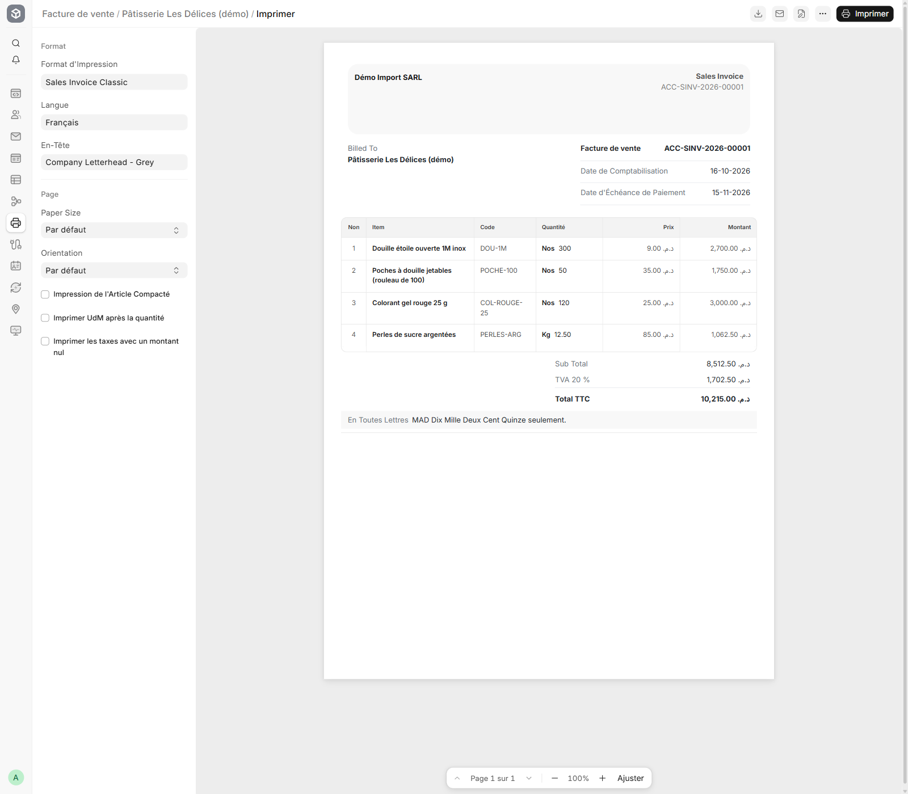

# Test Phase 0 : une importation de Chine dans ERPNext v16

Document de séance pour la revue avec l'expert-comptable (CHW-77, CHW-78).

**But du test :** voir comment ERPNext standard comptabilise une importation complète, puis décider si ERPNext convient. Rien n'est encore développé : c'est ERPNext v16 sans module marocain.

**Toutes les données sont fictives** : société, fournisseurs, client, ICE, montants et taux.

## Accès

- Adresse : `http://phase0-demo.localhost:8000` (poste de démonstration)
- Utilisateur : `Administrator`, mot de passe `admin`
- Société : **Démo Import SARL** (abréviation DI), devise MAD, exercice 2026
- Script qui recrée tout le site : `bangicode-infra/dev/scripts/phase0_seed.py`

## Hypothèses

| Élément | Valeur |
| -- | -- |
| Taux USD/MAD à la commande et à la réception | 10,00 |
| Taux USD/MAD au paiement du fournisseur | 10,12 |
| Droits de douane | 10 % de la valeur CAF |
| TPI (taxe parafiscale à l'importation) | 0,25 % de la valeur CAF |
| TVA à l'importation | 20 % de (CAF + droits + TPI) |
| Méthode de valorisation du stock | Coût moyen pondéré (CMUP) |
| Arrondi des totaux | Désactivé (pas d'arrondi au dirham) |

## Plan comptable

Le plan est numéroté selon le CGNC : classe (1 chiffre), rubrique (2), poste (3), compte (4), sous-compte (5). Il contient seulement les comptes du test.

| Compte | Intitulé | Rôle dans ERPNext |
| -- | -- | -- |
| 1111 | Capital social | Apport initial |
| 3111 | Marchandises | Stock (inventaire permanent) |
| 3421 | Clients | Créances clients |
| 34552 | État - TVA récupérable sur charges | TVA déductible, y compris TVA import |
| 44111 | Fournisseurs - MAD | Fournisseurs locaux |
| 44112 | Fournisseurs étrangers - USD | Fournisseur chinois, tenu en USD |
| 4417 | Fournisseurs - factures non parvenues | Réception non encore facturée |
| 4455 | État - TVA facturée | TVA collectée |
| 5141 | Banques | Banque |
| 61113 | Frais d'approche - transport et assurance | Compte de passage des frais d'approche |
| 61114 | Frais d'approche - droits de douane et TPI | Compte de passage des frais d'approche |
| 61115 | Frais d'approche - transit et transport local | Compte de passage des frais d'approche |
| 61141 | Variation des stocks - coût des ventes | Coût des marchandises vendues |
| 6331 | Pertes de change | Écart de change réalisé |
| 7111 | Ventes de marchandises au Maroc | Chiffre d'affaires |

## Parcours et écritures

Montants en MAD.

### 1. Bon de commande fournisseur (PUR-ORD-2026-00001, 01/09/2026)

Guangzhou Sweet Tools Co. (démo), en USD : 4 articles pour 2 851,50 USD. La commande ne passe pas d'écriture.

| Article | Quantité | Prix USD |
| -- | -- | -- |
| Douille étoile ouverte 1M inox | 2 000 | 0,35 |
| Poches à douille jetables (rouleau de 100) | 500 | 1,20 |
| Colorant gel rouge 25 g | 1 000 | 0,80 |
| Perles de sucre argentées | 250,5 kg | 3,00 |

### 2. Réception (MAT-PRE-2026-00001, 05/10/2026) et facture fournisseur (ACC-PINV-2026-00001)

- Réception à 10,00 : D 3111 / C 4417 pour **28 515,00**.
- Facture fournisseur : D 4417 / C 44112 pour **28 515,00** (2 851,50 USD).

### 3. Factures des frais d'importation (06/10/2026)

| Pièce | Tiers | Écriture |
| -- | -- | -- |
| ACC-PINV-2026-00002 | Transitaire : fret 3 200,00 + assurance 400,00, sans TVA | D 61113 3 600,00 / C 44111 3 600,00 |
| ACC-PINV-2026-00003 | Transitaire : transit 1 500,00 + TVA 20 % | D 61115 1 500,00, D 34552 300,00 / C 44111 1 800,00 |
| ACC-PINV-2026-00004 | Transporteur : Tanger Med - Tétouan 600,00 + TVA 14 % | D 61115 600,00, D 34552 84,00 / C 44111 684,00 |
| ACC-PINV-2026-00005 | Douane (DUM) : droits 3 211,50 + TPI 80,29 + TVA import 7 081,36 | D 61114 3 291,79, D 34552 7 081,36 / C 44111 10 373,15 |

Calcul douane : CAF = 28 515,00 + 3 200,00 + 400,00 = 32 115,00. Droits = 3 211,50. TPI = 80,29. TVA import = 20 % × 35 406,79 = 7 081,36. La TVA import est une ligne de taxe de la facture, pas une ligne d'article.

### 4. Frais d'approche sur le stock (MAT-LCV-2026-00001)

Le bordereau de frais d'approche répartit **8 991,79** de frais sur la réception, au prorata de la valeur :

- D 3111 8 991,79 / C 61113 3 600,00, C 61114 3 291,79, C 61115 2 100,00.
- Les comptes 6111x reviennent à zéro. Le stock porte le coût de revient complet : **37 506,79**, soit +31,53 % sur le prix d'achat.

| Article | Prix d'achat unitaire | Coût de revient unitaire |
| -- | -- | -- |
| Douille 1M | 3,5000 | 4,6037 |
| Poches (rouleau) | 12,0000 | 15,7840 |
| Colorant 25 g | 8,0000 | 10,5227 |
| Perles (kg) | 30,0000 | 39,4601 |

### 5. Règlements fournisseurs (10/10/2026)

- Fournisseur chinois, 2 851,50 USD payés à 10,12 : D 44112 / C 5141 pour **28 857,18**.
- Écart de change, en pièce séparée (ACC-JV-2026-00002) : D 6331 / C 44112 pour **342,18**.
- Transitaire, transporteur et douane : D 44111 / C 5141 pour 3 600,00, 1 800,00, 684,00 et 10 373,15.

### 6. Vente (16/10/2026)

Commande client SAL-ORD-2026-00001, puis bon de livraison MAT-DN-2026-00001, puis facture ACC-SINV-2026-00001. Client : Pâtisserie Les Délices (démo).

- Livraison : D 61141 / C 3111 pour **3 926,27** (coût de revient des articles vendus).
- Facture : D 3421 10 215,00 / C 7111 8 512,50, C 4455 1 702,50.
- Quantité décimale acceptée : 12,5 kg de perles.

### 7. Encaissement (ACC-PAY-2026-00006, 20/10/2026)

D 5141 / C 3421 pour **10 215,00** (chèque).

### 8. Contrôle

La balance générale est équilibrée (total 0,00). Marge brute de la vente : 8 512,50 − 3 926,27 = 4 586,23.

## Ce que l'ERPNext standard ne fait pas encore

Ces points font partie du package marocain prévu au devis (`morocco_localization`).

1. **Facture conforme à l'art. 145 CGI.** L'impression standard n'affiche ni l'ICE société, ni l'ICE client, ni l'IF, le RC ou le mode de paiement. Le montant en lettres est « MAD Dix Mille Deux Cent Quinze seulement. » au lieu de « Arrêtée la présente facture à la somme de dix mille deux cent quinze dirhams TTC ». Le symbole est د.م. au lieu de DH, et les nombres s'affichent en format anglais (1,062.50).
2. **Change.** Un seul compte est utilisé pour les pertes et les gains : un gain diminuerait 6331 au lieu d'aller en 7331. À la clôture, ERPNext ne passe pas d'écarts de conversion (370 / 470).
3. **TVA sur encaissements.** ERPNext calcule la TVA à la date de facture. Il manque aussi la date de déduction (paiement ou quittance douane) et le relevé des déductions au format SIMPL-TVA.
4. **États de synthèse CGNC.** Le bilan, le CPC et l'ESG au format CGNC ne sont pas fournis.
5. **Règles de caisse.** Le droit de timbre de 0,25 % sur les ventes en espèces et l'alerte sur les paiements fournisseurs en espèces ne sont pas fournis.
6. **Frais d'approche.** La répartition se fait par valeur, par quantité ou manuellement. Le poids et le volume sont prévus au devis (module `trade_import`).
7. **Douane.** Les droits et la TVA import sont calculés ici au taux comptable. En production, ils sont saisis depuis la DUM (taux de change de la douane, arrondi au dirham).

## Points à valider par l'expert-comptable

1. **Inventaire permanent.** ERPNext suit le stock en permanence : le coût des ventes passe en 61141 à chaque livraison. Le CGNC présente plutôt 6111 achats et 6114 variation de stock en fin d'exercice. Faut-il un reclassement de clôture, un état de présentation, ou autre chose ?
2. **Frais d'approche.** Faut-il garder les comptes de passage 61113 à 61115, ou utiliser un compte de passage de classe 4 ?
3. **Fournisseurs étrangers.** Est-ce que 44112 en USD convient, ou faut-il un seul 4411 avec un sous-compte par fournisseur ?
4. **Réceptions non facturées.** Est-ce que 4417 convient ?
5. **Douane.** Est-elle traitée comme un fournisseur (44111), avec un compte État dédié, ou comme débours du transitaire ? Même question pour le fret refacturé sans TVA.
6. **TVA import.** Dans 34552, ou dans un sous-compte dédié ?
7. **Taux de change.** Pour valoriser la marchandise importée, faut-il le taux de la facture ou celui de la DUM ?
8. **Régime de TVA.** Débit ou encaissement ? Déclaration mensuelle ou trimestrielle ?
9. **TPI et taux.** La TPI s'applique-t-elle ? Quels taux de TVA par famille de produits ?
10. **Arrondis.** Un seul compte 6588, ou 6588 et 7588 selon le sens ?

## Décision

| Réponse de l'expert-comptable | Suite |
| -- | -- |
| Les écritures conviennent, avec les ajustements ci-dessus | ERPNext : on chiffre le package marocain et on envoie la proposition (CHW-80) |
| Bloquant non contournable | Odoo (plan de repli, voir MaroneERP-context.md section 3) |

